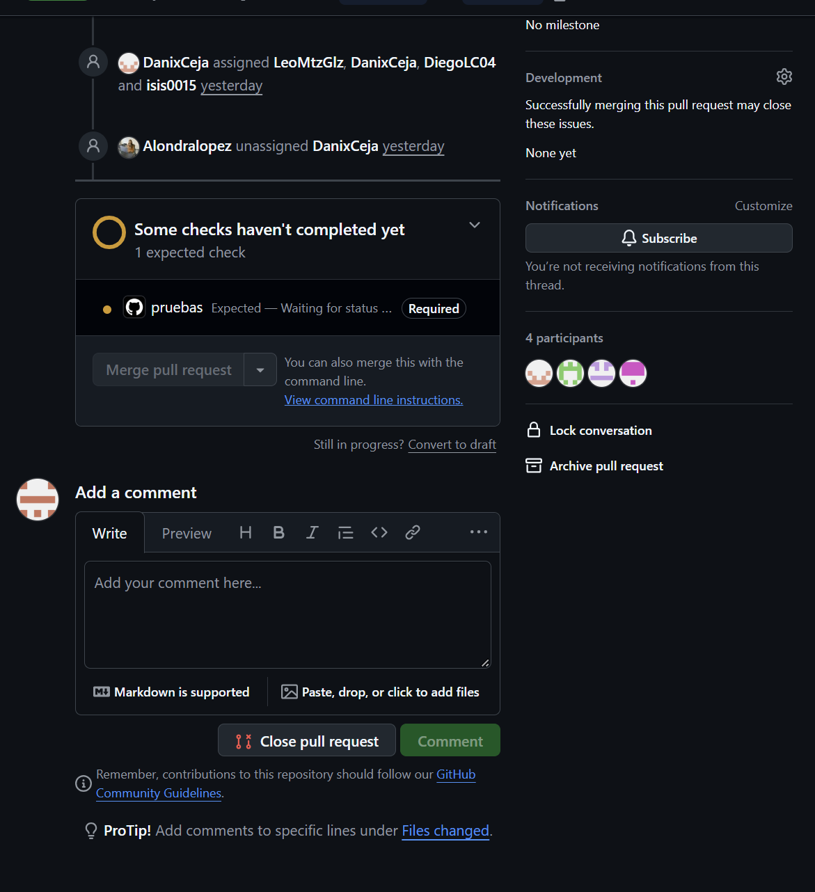

# T-06 — Configurar pruebas automáticas e integración continua

## ST-30. Proteger la rama principal

**Estado:** Completada  
**Responsable:** l22420415

### 1. Descripción

Las ramas `development` y `main` quedaron protegidas con un *ruleset* de GitHub: ya no se puede subir código directo a ellas y todo cambio entra por Pull Request, que solo se puede fusionar cuando el check **`pruebas`** del workflow **CI** (ST-29) termina en verde.

La configuración en GitHub la hizo el profesor, como dueño del repositorio. Esta subtarea documenta cómo quedó, cómo comprobar que funciona y qué hacer en una emergencia.

### 2. Configuración del ruleset

| Opción | Valor |
|---|---|
| Nombre | `proteccion-ramas` |
| Tipo | Branch ruleset |
| Enforcement status | **Active** |
| Bypass list | Repository admin |
| Target branches | `development` y `main` |
| Restrict deletions | Activado |
| Block force pushes | Activado |
| Require a pull request before merging | Activado |
| Required approvals | 0 |
| Require status checks to pass | Activado, con el check **`pruebas`** (job del workflow CI de ST-29) |
| Require branches to be up to date before merging | **Desactivado** |

**¿Por qué no se exige que la rama esté actualizada?** Con esa opción, cada vez que alguien fusiona un PR, todos los demás PR abiertos quedan "desactualizados" y hay que traer `development` otra vez y esperar a que el CI vuelva a correr antes de poder fusionar. Con 17 personas fusionando en el mismo sprint, eso se vuelve una fila interminable de actualizaciones. El CI ya corre sobre el resultado de la fusión (`pull_request` prueba el merge del PR con su rama base), así que el riesgo que queda es bajo.

### 3. Qué significa en la práctica

- **No hay push directo** a `development` ni a `main`: GitHub rechaza el `git push`.
- **Todo entra por Pull Request.** El flujo es: rama `t-XX/st-YY` → push de la rama → PR hacia `development`.
- **Un PR solo se fusiona con `pruebas` en verde.** Si ruff, las migraciones o las pruebas fallan, el botón de merge queda bloqueado.
- Las ramas protegidas **no se pueden borrar** ni reescribir con `git push --force`.
- Los administradores del repositorio están en la *bypass list*: pueden saltarse las reglas, solo para emergencias.

### 4. Cómo se configuró

Solo el **dueño del repositorio** (o alguien con rol *Admin*) puede crear o cambiar rulesets.

1. En GitHub, abrir el repositorio → **Settings**.
2. En el menú lateral: **Rules → Rulesets**.
3. **New ruleset → New branch ruleset**.
4. **Ruleset name:** `proteccion-ramas`.
5. **Enforcement status:** `Active`.
6. **Bypass list → Add bypass:** `Repository admin`.
7. **Target branches → Add target → Include by pattern:** `development`; repetir con `main`.
8. En **Branch rules**, activar:
   - **Restrict deletions**.
   - **Block force pushes**.
   - **Require a pull request before merging**, con **Required approvals** en `0`.
   - **Require status checks to pass** → **Add checks** → escribir `pruebas` y elegirlo (origen: GitHub Actions). Dejar **sin marcar** *Require branches to be up to date before merging*.
9. **Create**.

> El check `pruebas` solo aparece en el buscador de **Add checks** después de que el workflow CI haya corrido al menos una vez en el repositorio.

### 5. Cómo comprobar que funciona

1. **El check es obligatorio:** en cualquier PR hacia `development`, la sección de checks muestra **CI / pruebas** con la etiqueta **Required**.
2. **El merge se bloquea:** mientras `pruebas` está en curso o en rojo, el botón de merge aparece deshabilitado con el aviso de que faltan checks requeridos.
3. **El push directo se rechaza** (probarlo con una cuenta que no sea admin, porque los admins están en la bypass list):

   ```bash
   git switch development
   git commit --allow-empty -m "prueba de protección"
   git push origin development
   # remote: error: GH013: Repository rule violations found for refs/heads/development.
   # ! [remote rejected] development -> development (push declined due to repository rule violations)
   git reset --hard origin/development   # deshacer el commit de prueba
   ```

**Evidencia observada:** los PR que se abrieron antes de que existiera `ci.yml` (ST-29) quedaron en **"Expected — Waiting for status to be reported"** y no se pudieron fusionar hasta que se actualizaron con `development`. Eso confirma que el ruleset exige el check `pruebas`.

### 6. Problemas comunes

| Síntoma | Causa | Solución |
|---|---|---|
| El PR muestra **pruebas — Expected — Waiting for status to be reported** y nunca avanza | La rama se creó antes de ST-29 y no tiene `.github/workflows/ci.yml`, así que el CI nunca corre para ella | Actualizar la rama con `development` (botón **Update branch** o `git pull origin development` y push); al subir, el CI corre y reporta el check |
| Una ejecución del CI aparece **cancelada** (círculo gris) | `concurrency` con `cancel-in-progress` (ST-29): un push nuevo a la misma rama cancela la ejecución anterior | No es un error. Cuenta la **última** ejecución; esperar a que termine |
| `pruebas` en rojo | Falló ruff, la revisión de migraciones o pytest | Ver la sección 6 de `docs/T-06/ST-29-workflow-github-actions.md` |
| `git push` rechazado con `GH013` | Se intentó subir directo a `development` o `main` | Crear una rama `t-XX/st-YY`, subirla y abrir un PR |

### 7. Desactivar la protección en una emergencia

Si hace falta saltarse las reglas temporalmente (por ejemplo, GitHub Actions está caído y hay que fusionar una corrección urgente), el dueño del repositorio puede:

1. **Settings → Rules → Rulesets → `proteccion-ramas`**.
2. Cambiar **Enforcement status** a **Disabled** y guardar.
3. Hacer el cambio urgente.
4. **Regresar Enforcement status a Active** en cuanto termine y avisar al equipo.

No se borra el ruleset: desactivarlo conserva toda la configuración para volver a activarla igual.

### 8. Recomendaciones para el profesor

- **Subir *Required approvals* a 1.** El backlog v3 asigna un revisor a cada subtarea; con 0 aprobaciones un PR se puede fusionar sin que su revisor lo haya aprobado.
- **Activar Settings → General → Pull Requests → *Always suggest updating pull request branches*.** Así aparece el botón **Update branch** en los PR desactualizados. Usar siempre **Update with merge commit** (no *rebase*), para no reescribir commits que otros ya descargaron.
- **Fusionar siempre con *Create a merge commit*** y pasar `development` a `main` con un PR al final de cada sprint, para que `main` quede como la versión entregada de cada sprint.

### 9. Evidencia

Captura del check `pruebas` marcado como **Required** en un PR:



### 10. Resultado

`development` y `main` están protegidas: no aceptan push directo, force push ni borrado, y todo cambio entra por Pull Request con el check `pruebas` del CI en verde.

**ST-30 finalizada.**

**Responsable de la actividad:** l22420415.
